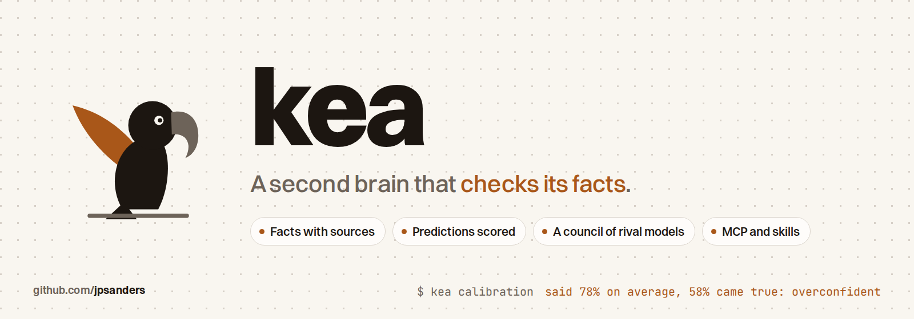

<p align="center">
  <picture>
    <source media="(prefers-color-scheme: dark)" srcset="https://raw.githubusercontent.com/jpsanders/kea/main/docs/images/banner-dark.png">
    
  </picture>
</p>

<p align="center">
  <a href="https://github.com/jpsanders/kea/actions/workflows/dev.yml"></a>
  <a href="https://github.com/jpsanders/kea/releases/latest"></a>
  <a href="https://pypi.org/project/kea-brain/"></a>
  <a href="https://www.python.org/downloads/"></a>
  <a href="https://github.com/jpsanders/kea/blob/main/pyproject.toml"></a>
  <a href="https://github.com/jpsanders/kea#use-it-with-your-ai-agent"></a>
  <a href="https://github.com/jpsanders/kea#use-it-with-your-ai-agent"></a>
  <a href="https://github.com/jpsanders/kea/tree/main/skills"></a>
  <a href="https://mypy-lang.org/"></a>
  <a href="https://github.com/psf/black"></a>
  <a href="https://github.com/jpsanders/kea/blob/main/LICENSE"></a>
  <a href="https://github.com/jpsanders/kea/commits/main"></a>
  <a href="https://github.com/jpsanders/kea/stargazers"></a>
</p>

**Your AI agent remembers everything you told it, including the things that were never true.** kea is a second
brain for you and your agents that keeps the difference: every fact carries a source and a date, every decision
carries the day you will look at it again, every prediction gets scored against what happened, and every big plan
faces a council of rival AI models before you commit. It also makes everything you ever said to Claude Code, Codex,
OpenCode, ChatGPT and Claude searchable, on your machine.

Plain Markdown in a folder you own. One Python package with no dependencies. A CLI, an MCP server, three agent skills
and a Claude Code plugin.

```sh
uv self update      # or brew upgrade uv, or pip install -U uv: an older uv knows only the 3.15 previews
uv tool install --python 3.15 kea-brain   # fetches Python 3.15
kea init ~/tidewater --example && cd ~/tidewater && kea status
```

```text
kea Tidewater Coffee · ~/tidewater
  state        updated yesterday · 7 facts, 1 past recheck · 1 UNVERIFIED
  decisions    2 active · 1 due for revisit (D-0002)
  predictions  3 open · 1 due to score (P-0007) · 6 scored, Brier 0.23 (+7% vs a coin)
  roadmap      2 waiting for Mara · 3 next · 1 date in 14 days
  ideas        2 parked
  plan         second-cafe: reviewed, 3 reviews → kea synth second-cafe
  council      0 of 6 seats ready · the Chair is your own agent
  evidence     nothing indexed yet: kea ingest claude-code

health
  ✓ STATE.md is fresh · last entry yesterday
  ! facts are sourced and rechecked · 1 of 7 facts past their recheck
  ! decisions are revisited on time · 1 due
  ! predictions are scored · 1 past their date
  ✓ frameworks have boundary conditions · 0 of 1 incomplete
  ✓ decided plans carry 3 predictions · no decided plans yet
  3 of 6 checks need attention. Fix the oldest first.
```

That is the example brain: Tidewater Coffee, a made up roastery deciding whether to open a second cafe. Every number
in it is invented, and every line above is real output.

## Why

Second brains are good at collecting and bad at checking. Notes pile up, half of them guesses, and an AI agent that
reads them repeats the guesses back with total confidence. Decisions get made and never revisited. Predictions get
made and never scored, so nobody learns whether "I'm 80% sure" means anything. And the big calls get validated by one
model that was trained to agree with you.

kea began as the private system its author works from: a folder of Markdown, a council of free model endpoints and a
SQLite index over past AI conversations. This repository is that system with the private data taken out, made
general, tested, and shipped for anyone.

## What it does

**Facts with receipts.** STATE.md holds a facts table (fact, value, source, verified date) and a dated log. Anything
not checked is marked UNVERIFIED and says how it would be checked. `kea check` lints the lot: unsourced facts, facts
past their recheck date, stale state.

```sh
kea fact "Cash on hand" "EUR 18,400" --source "bank export"
kea log "Five sample bags sent to cafes" --source journal/wholesale-samples.md
```

**Decisions that come back.** Every decision carries the reasoning and a revisit date. When the date comes, kea asks
what happened, how surprising it was, and what changes.

```sh
kea decide "Test wholesale first" --decision "Five sample bags before any lease" --why "roaster at 40%" --revisit +30d
kea revisit D-0003 --outcome "Two cafes ordered" --surprise 3 --lesson "Ask for volume, not a yes"
```

**Predictions that get scored.** Write them down with a date and a confidence, score them when the date comes, and
find out whether your 80% means 80%:

```text
$ kea calibration
6 scored predictions · Brier 0.233 (0 is perfect, 0.25 is a coin) · +7% skill over a coin
said 78% on average, 58% came true: overconfident

  said       count  came true
  60 to 69%      1  ██████████··········  50%
  70 to 79%      1  ████████████████████ 100%
  80 to 89%      2  ····················   0%
  90 to 100%     2  ████████████████████ 100%
```

**A council of rival models.** For the decisions that are expensive to reverse, `kea brief` builds one packet with the
facts, the frameworks the plan names and the plan, and hashes it. `kea council` sends it to every ready seat in
parallel: Gemini, DeepSeek, OpenAI's open weights on Groq, Mistral, and two local models by default, twelve providers
preset, any OpenAI compatible server welcome. No seat sees another's review. Your own agent is the Chair: it reviews
first from the packet alone and writes the synthesis last, including the section on what every seat missed, because
models that share training data share blind spots.

```text
$ kea synth second-cafe
3 of 3 reviews parsed · verdicts: PROCEED_WITH_CHANGES 2, PROCEED 1
4 recommendations: 1 strong, 0 split, 3 solo
wrote plans/second-cafe/10-synthesis-scaffold.md · now the Chair writes 11-synthesis.md: what every seat missed
```

**Search everything you ever told an AI.** `kea ingest` indexes your Claude Code, Codex and OpenCode sessions, your
ChatGPT and Claude exports, your git history and your notes into SQLite with FTS5, read only, incrementally, with
credential paths refused and secrets redacted. Every hit points back to its exact file and line, message or commit.
`kea effort` shows where your attention actually went, project by project.

```sh
kea ingest claude-code && kea ingest codex && kea ingest git ~/code
kea search "why did we drop the market stall" --mine
```

**A roadmap that survives the session.** ROADMAP.md keeps what waits for you apart from what comes next, so an agent
puts its questions where you will see them instead of guessing. `kea roadmap add "..." --waiting`.

## Use it with your AI agent

kea is built to be used by agents as much as by people. Every command takes `--json`, `kea guide` prints the whole
manual, and every brain carries an `AGENTS.md` (and a `CLAUDE.md` that imports it) with the rules and the session
routine.

**Skills** for Claude Code, Codex, OpenCode and any agent that reads `~/.agents/skills`:

```sh
kea skill install        # into ~/.claude/skills (Claude Code, OpenCode) and ~/.agents/skills (Codex and more)
```

**Claude Code plugin**, with the skills and the MCP server in one:

```text
/plugin marketplace add jpsanders/kea
/plugin install kea@kea
```

The plugin starts its MCP server with `uvx --python 3.15`, so update uv first, as in Install below.

**MCP server** with 25 tools (search, show, brain_status, log_entry, record_fact, decide, predict, score_prediction,
roadmap_add, council_run and more), five resources and three prompts:

```sh
claude mcp add --scope user kea -- kea mcp        # Claude Code
```

```toml
# Codex: ~/.codex/config.toml
[mcp_servers.kea]
command = "kea"
args = ["mcp"]
```

```json
{"mcpServers": {"kea": {"command": "kea", "args": ["mcp"], "env": {"KEA_BRAIN": "/home/you/brain"}}}}
```

The JSON works for Cursor (`~/.cursor/mcp.json`) and Gemini CLI (`~/.gemini/settings.json`). For Claude Desktop, put
the full path from `which kea` as the command, because it starts servers without your shell's PATH. Without kea
installed, use `uvx` with `--python 3.15 --from kea-brain kea mcp`, after updating uv as in
Install.

An agent can read and keep the ledger, but two things stay yours: it can only rescan sources you added in a terminal,
and it can only send a council packet off your machine if your `kea.toml` says `[council] agents_may_send = true`.

## The rules

1. **Verified facts only.** A fact has a source and a date. Everything else is UNVERIFIED and says how to check it.
2. **Never present an estimate as a measurement.**
3. **Log decisions** with the reasoning and the day you will look again. Unlogged reasoning does not compound.
4. **Write predictions down and score them.** A prediction names a number and a date.
5. **Import distilled, not raw.** Name the decision a source changes before you import it.
6. **Frameworks only with boundary conditions.** A lens cited outside its stage manufactures confidence.
7. **Consensus is a signal, not a verdict.** Ask what every seat was trained not to see.
8. **Ask, do not assume.** Questions for the owner go on the roadmap, never into a guess.

## Install

```sh
uv tool install --python 3.15 kea-brain       # recommended
pipx install --python python3.15 kea-brain
pip install kea-brain                         # in a Python 3.15 environment
docker build -t kea . && docker run --rm -it --user "$(id -u):$(id -g)" -v ~/brain:/brain kea status
```

kea needs Python 3.15; with `--python 3.15`, uv downloads it for you. Update uv first, since an older uv knows only
the 3.15 previews: `uv self update`, or `brew upgrade uv` or `pip install -U uv` when that is how uv came. The
distribution is called `kea-brain` and the command is `kea`.
Then `kea man --install` makes `man kea` work.

## Commands

| Command | What it does |
| --- | --- |
| `kea init [path] [--example]` | Make a brain (the first real one becomes your default), or put back missing files |
| `kea status` / `kea check` | The whole brain with health checks / lint it, exit 1 on errors |
| `kea state` / `kea log` / `kea fact` | Facts and the dated log |
| `kea decide` / `kea decisions` / `kea revisit` | Decisions and closing their loop |
| `kea predict` / `kea score` / `kea calibration` | Predictions, outcomes, Brier score |
| `kea roadmap [add\|done]` / `kea idea` | Open work and parked ideas |
| `kea plan new` / `kea brief` / `kea council` / `kea synth` | A council review, end to end |
| `kea ingest` / `kea search` / `kea show` / `kea effort` | The evidence index |
| `kea digest [transcript]` | A Claude Code session as readable files |
| `kea mcp` / `kea skill install` | Agents |
| `kea guide` / `kea man` | The full manual, for people and agents |

Everything is in the [manual](https://github.com/jpsanders/kea/blob/main/docs/MANUAL.md): `kea guide` prints it, `man kea` shows it.

## Privacy

Your brain is a folder you own; the index is a SQLite file inside it, readable only by you, that git ignores. kea has
no telemetry and no account. Ingest opens your sources read only, never opens paths such as `.ssh`, `.aws`, `.env`,
shell histories or `credentials` (a symbolic link is judged by where it points, and skipped if it leads out of a
folder you ingest), and redacts anything shaped like a key or a token before storing it and before a packet leaves.
What you write into the ledger loses only unmistakable key shapes, so your own words stay as you wrote them. The only
thing that ever leaves your machine is a council packet, and `kea council` asks first, naming every host. API keys
travel in headers, never in URLs, and no request follows a redirect. More in [SECURITY.md](https://github.com/jpsanders/kea/blob/main/SECURITY.md).

## Performance

One package, the standard library only, and Python 3.15's lazy imports: `kea --version` returns in about 30 ms and
`kea status` in about 70 ms. Measured on one Linux machine, 1.3 GB of Claude Code transcripts index in under five
seconds, a second run
takes a tenth of a second because unchanged files are skipped, and a search over thousands of messages answers in
about 50 ms. `make bench` measures it on your machine.

## Why the name

The kea is New Zealand's alpine parrot: one of the cleverest birds alive, famous for taking apart whatever it finds to
see how it works. Its underwings are orange. It is the sibling of [huntaway](https://github.com/jpsanders/huntaway),
the sheepdog that guards your machine; kea guards your thinking.

## Star history

<a href="https://star-history.com/#jpsanders/kea&Date">
  <picture>
    <source media="(prefers-color-scheme: dark)" srcset="https://api.star-history.com/svg?repos=jpsanders/kea&type=Date&theme=dark">
    
  </picture>
</a>

## Contributing

Issues and pull requests are welcome; see [CONTRIBUTING.md](https://github.com/jpsanders/kea/blob/main/CONTRIBUTING.md). Built on
[python-package-template](https://github.com/jpsanders/python-package-template).

## Licence

MIT. Made by [James Phillip Sanders](https://jamesphillipsanders.com).
